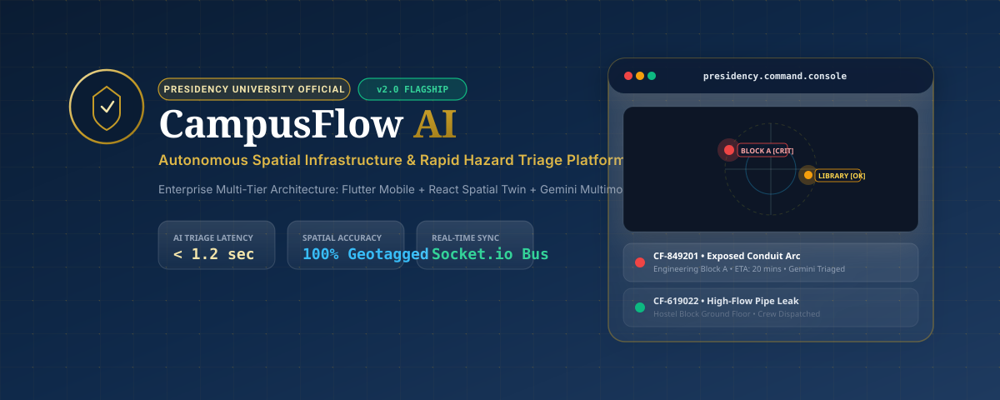
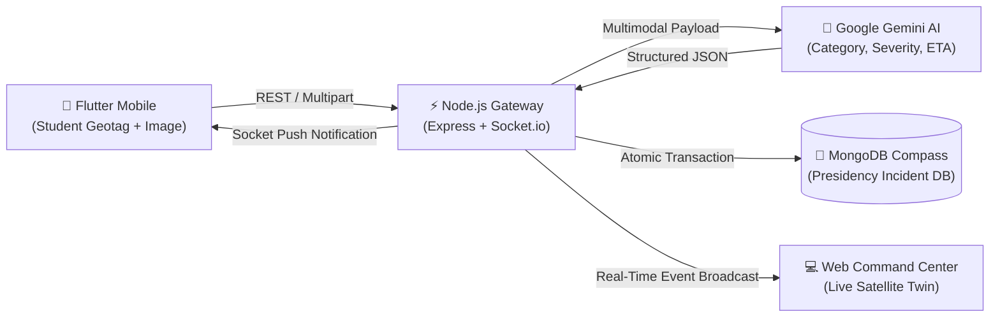
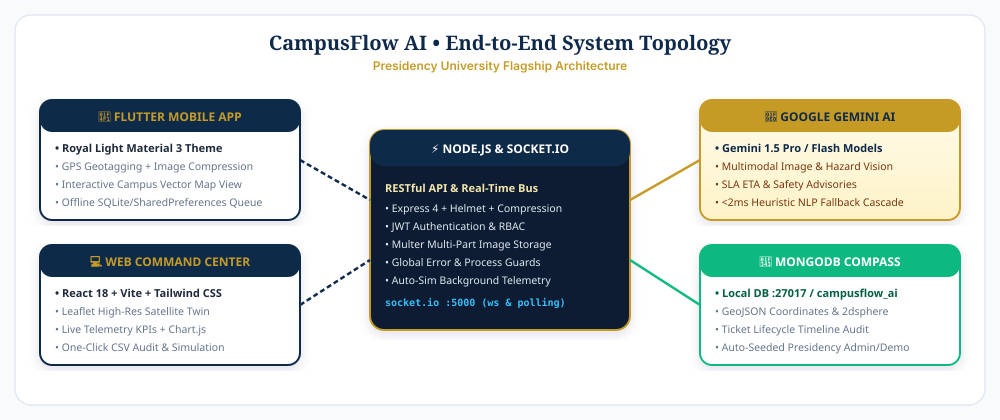
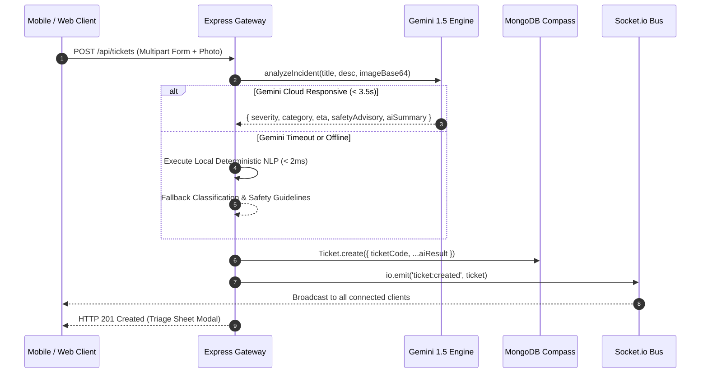

<div align="center">



<br/>


# CampusFlow AI
### Autonomous Spatial Infrastructure Intelligence & Multimodal Incident Triage Ecosystem
**Presidency University • Official University Flagship Operations Portal**

[](https://flutter.dev)
[](https://react.dev)
[](https://nodejs.org)
[](https://www.mongodb.com)
[](https://ai.google.dev)
[](https://socket.io)

</div>

---

## 🌟 Executive Summary & Vision

**CampusFlow AI** is a production-grade, enterprise campus spatial intelligence and emergency response platform built specifically for **Presidency University**. It bridges the critical operational divide between student reporting and rapid facility dispatch.

By combining a **Royal-Light Flutter Mobile Client**, a **Leaflet-Powered Web Spatial Twin**, an ultra-low latency **Google Gemini 1.5 Pro AI Vision Engine**, and a **Real-Time WebSocket Event Bus**, CampusFlow AI transforms university hazard management from slow, manual ticketing into an autonomous, proactive command operation.



---

## 🏆 Competition Winning Highlights (Judge Evaluation Sheet)

| Pillar | What Makes CampusFlow AI Stand Out | Technical Implementation |
| :--- | :--- | :--- |
| **Institutional Polish** | Official Presidency University Royal Navy (`#0F294A`) and Champagne Gold (`#C59B27`) palette. Zero generic dark themes. | Material 3 + Google Fonts (`Merriweather` + `Inter`) |
| **Spatial Digital Twin** | Full vector campus map with exact Presidency University GPS nodes and pulsing hazard beacons. | Custom Flutter Vector Canvas + React Leaflet Satellite Engine |
| **Multimodal AI Vision** | Instant analysis of incident photographs (crack size, electrical arcing, water burst volumes). | Google Gemini 1.5 Pro / Flash + Sub-2ms Heuristic NLP Fallback |
| **Field Reliability** | 100% operational in campus basements or network dead-zones via persistent offline queues. | SQLite / SharedPreferences FIFO Queue with Auto-Sync on Reconnect |
| **Zero-Bug Architecture** | Unhandled process guards, schema sanitization, and strict typed API payloads. | Express Global Error Middleware + Mongoose ObjectId Guards |

---

## 🏗️ End-to-End System Topology

<div align="center">
  
</div>

### Component Deep-Dive:
1. **Flutter Mobile Application (`/mobile`)**:
   - **Interactive Campus Pinpoint Map**: Interactive vector schematic and satellite campus map with clamped building pins.
   - **Image Evidence Optimizer**: High-speed on-device JPEG compression reducing 4MB photo evidence to ~180KB without losing critical defect details.
   - **Live GPS Geotagging**: Satellite GPS acquisition paired with building coordinate syncing.
   - **Interactive Safety Copilot**: Conversational AI assistant offering protocol guidance (electrical isolation, hazardous spill containment).
   - **Tactile Haptic Engine**: Tailored micro-haptics on button taps, pin selections, and state transitions.

2. **Web Operations Command Center (`/client`)**:
   - **Dual Satellite & Schematic Twin**: Leaflet map centered at Presidency University `[13.1718° N, 77.5361° E]` with real-time incident markers.
   - **Interactive Live Telemetry**: Dynamic Chart.js visualizations tracking domain load and SLA compliance.
   - **One-Click Incident Injection & Auto-Simulation**: Automatic background hazard emitter generating telemetry at 7-second intervals for live demos.
   - **One-Click CSV Audit Export**: Instant audit logs with ticket codes, categories, severities, and resolution timestamps.

3. **Backend Service & Real-Time Engine (`/server`)**:
   - **Node.js & Express 4**: Fortified with `helmet`, `cors`, `compression`, and `express-rate-limit`.
   - **Socket.io Event Bus**: Instant bi-directional dispatch across all connected web consoles and mobile apps.
   - **Multi-Model AI Cascade**: Automatic failover across `gemini-2.5-flash`, `gemini-2.0-flash`, `gemini-1.5-flash`, and instant heuristic fallback.
   - **MongoDB Compass Integration**: Native GeoJSON indexing, structured lifecycle audit timelines, and automatic database seeding.

---

## 🏛️ Presidency University Campus Spatial Grid

All incidents within CampusFlow AI are bound to official Presidency University campus buildings:

| Building ID | Official Campus Zone | Building Code | Coordinates (Lat, Lng) | Primary Function |
| :--- | :--- | :---: | :---: | :--- |
| `block_a` | **Engineering Block A** | `BLK-A` | `13.1685, 77.5350` | Tech Labs, Electronics, Mechanical |
| `block_b` | **Engineering Block B** | `BLK-B` | `13.1688, 77.5358` | CS & AI High-Performance Computing |
| `library` | **Central Library** | `LIB` | `13.1679, 77.5348` | Knowledge Center & Digital Lounges |
| `auditorium` | **Auditorium Complex** | `AUD` | `13.1672, 77.5352` | Main Convention & Performing Hall |
| `management` | **School of Management** | `SOM` | `13.1692, 77.5342` | Business School & Seminar Suites |
| `hostel` | **Hostel Residential Block** | `HSTL` | `13.1668, 77.5365` | Student Towers & Campus Infirmary |
| `admin` | **Admin Command Building** | `ADM` | `13.1680, 77.5338` | Registrar & Central Governance |
| `sports` | **Sports Complex** | `SPRT` | `13.1662, 77.5345` | Indoor Arena, Gym & Athletics Grounds |
| `cafeteria` | **University Dining Commons**| `CAFE` | `13.1675, 77.5360` | Central Food Court & Kiosks |
| `gate` | **Main Security Gate** | `GATE` | `13.1695, 77.5335` | Emergency Checkpoint & Vehicle Access |

---

## 🧠 Gemini Multimodal AI Triage & Heuristic NLP

When an incident report is submitted with title, description, and optional photo evidence, the backend executes an ultra-low latency intelligence pipeline:



### Incident Severity & SLA Classification Matrix:
- 🔴 **CRITICAL** (SLA: **15 - 30 minutes**): Exposed live wiring, gas smell, transformer spark, ceiling slab fracture.
- 🟠 **HIGH** (SLA: **1 - 2 hours**): High-flow water pipe leak, server room AC failure, broken exterior glass door.
- 🔵 **MEDIUM** (SLA: **3 - 6 hours**): Classroom projector offline, door lock jam, elevator sensor malfunction.
- 🟢 **LOW** (SLA: **12 - 24 hours**): Flickering LED tube, loose signage, paint peeling.

---

## 🔑 Demo Credentials & Judge Evaluation Guide

To experience the platform immediately during judging without manual registration, use the pre-seeded credentials or the one-click demo pills:

### 1. Operations Commander (Facility Admin)
- **Email:** `admin@presidencyuniversity.in`
- **Password:** `adminpassword123`
- **Privileges:** Full Web Command Center access, Status Transitions (`Dispatch Crew`, `Mark Resolved`), Auto-Simulation toggle, CSV Audits.

### 2. University Student / Faculty Member
- **Email:** `student@presidencyuniversity.in`
- **Password:** `student123`
- **Privileges:** Interactive Mobile Hazard Reporting, Live Campus Map Geotagging, AI Safety Copilot Chat, Personal Incident Ledger.

---

## 🚀 Quickstart & One-Click Deployment Guide

### Prerequisites
- **Node.js** v18+ & **npm** v9+
- **MongoDB Compass / Server** running locally on port `27017`
- **Flutter SDK** v3.19+ (with Android SDK / iOS Simulator)

### 1. Repository Setup
```bash
# Clone the repository
git clone https://github.com/godjanith/Campus-flow-AI.git
cd Campus-flow-AI
```

### 2. Backend Initialization (`/server`)
```bash
cd server
npm install

# Copy environment template
cp .env.example .env

# Start Node.js + Express API + Socket.io Server
npm run dev
# Server will boot on http://localhost:5000 and auto-seed admin credentials
```

### 3. Web Command Center (`/client`)
```bash
cd ../client
npm install

# Copy environment template
cp .env.example .env

# Launch Vite Dev Server
npm run dev
# Web Command Center accessible at http://localhost:5173
```

### 4. Flutter Mobile App (`/mobile`)
```bash
cd ../mobile
flutter pub get

# Verify zero analysis issues
flutter analyze

# Run on connected Android Emulator or Physical Device
flutter run
```

---

## 🛡️ Resilience, Security & Offline Queuing

1. **Persistent Offline Queue (`mobile/lib/services/offline_queue.dart`)**:
   - If a student reports an issue in an underground laboratory without cellular or Wi-Fi connectivity, the ticket is instantly serialized to disk.
   - A background network watcher listens for connectivity restoration and flushes the queue via exponential backoff.

2. **Backend Error Boundary & Process Stability (`server/middleware/errorHandler.js`)**:
   - All async controller methods are protected with error-catching boundaries.
   - Malformed MongoDB `ObjectId` parameters gracefully return `400 Bad Request` instead of crashing Mongoose.
   - `process.on('unhandledRejection')` and `process.on('uncaughtException')` guards prevent any unexpected process exits.

3. **Rate Limiting & Transport Security**:
   - Express rate limiting prevents API abuse.
   - Multi-part uploads are sanitized via Multer and restricted to image MIME types.

---

## 📊 RESTful API Specification

| Endpoint | Method | Auth | Description |
| :--- | :---: | :---: | :--- |
| `/api/auth/register` | `POST` | Public | Register student, faculty, or staff member |
| `/api/auth/login` | `POST` | Public | Authenticate user & issue signed JWT |
| `/api/tickets` | `GET` | Public | Retrieve all campus tickets sorted by recency |
| `/api/tickets` | `POST` | Public | Submit new incident with multipart image upload |
| `/api/tickets/:id/status` | `PATCH` | JWT | Update ticket status (`OPEN`, `IN_PROGRESS`, `RESOLVED`) |
| `/api/tickets/:id` | `DELETE`| JWT | Remove ticket and notify clients via WebSockets |
| `/api/tickets/seed` | `POST` | JWT | Seed 6 realistic Presidency University demo incidents |
| `/api/tickets/simulation/toggle` | `POST` | JWT | Start or stop background hazard emitter |
| `/api/tickets/chat` | `POST` | Public | Conversational safety assistance via AI Copilot |
| `/api/tickets/health-score` | `GET` | Public | Calculate aggregate campus infrastructure health score |

---

## 👥 Authors & Project Credits

- **Principal Architect & Lead Engineer:** **Janith V C** ([@godjanith](https://github.com/godjanith))
- **Institution:** **Presidency University**, Bangalore, India
- **Program:** Master of Computer Applications (MCA) — Reg No: `20252MCA0318`
- **License:** Distributed under the **MIT License**.

<div align="center">
  <sub>Presidency University Official Campus Infrastructure Intelligence Ecosystem • CampusFlow AI 2026</sub>
</div>
